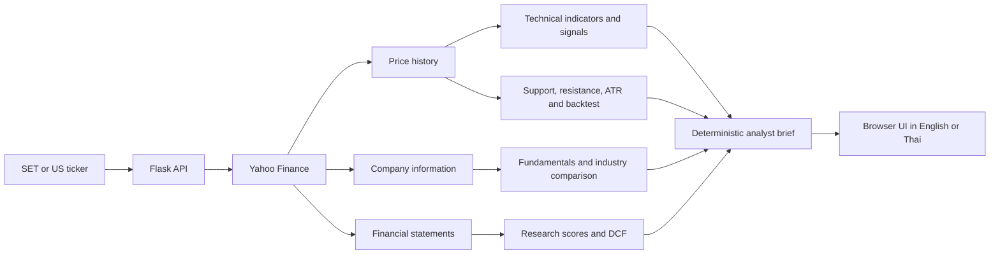

# Victor's Vector

**Bilingual stock research and trading-analysis workspace for Thai SET and US equities.**

Victor's Vector brings technical analysis, company fundamentals, valuation, research, portfolio tools, alerts, and paper trading into one browser-based application. Choose 🇹🇭 **SET** or 🇺🇸 **US**, search a ticker, and move from a high-level analyst brief into the underlying charts and numbers.

The application is designed for investors who want a repeatable research process without moving between several websites. It supports English and Thai, uses Yahoo Finance as its market-data source, and generates its analysis from structured market and financial data rather than an LLM.

> **Educational use only.** This project does not provide financial, investment, or trading advice.

## Contents

- [Markets and ticker format](#markets-and-ticker-format)
- [What the application does](#what-the-application-does)
- [Typical research workflow](#typical-research-workflow)
- [How the analysis works](#how-the-analysis-works)
- [Technology and architecture](#technology-and-architecture)
- [Run locally](#run-locally)
- [Configuration](#configuration)
- [API overview](#api-overview)
- [Project structure](#project-structure)
- [Data storage and limitations](#data-storage-and-limitations)
- [ภาษาไทย](#victors-vector-ภาษาไทย)

## Markets and ticker format

| Market | Input format | Internal lookup | Examples |
| --- | --- | --- | --- |
| Thailand — Stock Exchange of Thailand (SET) | Enter the local symbol without a suffix | The backend adds Yahoo Finance's `.BK` suffix | `PTT`, `AOT`, `CPALL`, `KBANK` |
| United States | Enter the standard exchange symbol | The symbol is used as entered | `AAPL`, `NVDA`, `TSLA`, `MSFT` |

Thai ticker search uses a curated SET symbol list. US search accepts equities and ETFs returned by Yahoo Finance. The market selector controls symbol normalization, search, currency context, and every downstream analysis request.

The **EN / TH** button switches the localized application labels. Translation files are in `static/i18n/en.json` and `static/i18n/th.json`.

## What the application does

### 1. Analyst-style Brief

The default Brief tab combines technical, fundamental, valuation, support/resistance, scenario, and thematic data into ten sections:

1. Current technical setup
2. Trend strength
3. Momentum
4. Support and resistance
5. Trader entry view
6. Long-term investor view
7. Bear, base, and bull scenarios
8. Potential catalysts
9. Key risks
10. Portfolio fit

The narrative is deterministic: the same structured inputs produce the same conclusions. No external AI model is required.

### 2. Interactive charts and technical signals

- Historical candlestick/price analysis from intraday intervals through multi-year daily periods
- Configurable SMA crossover, MACD, and Stochastic signal rules
- Buy, Hold, and Sell classifications with conservative, normal, or aggressive sensitivity
- EMA overlays with customizable periods
- Bollinger Bands, RSI, and rolling VWAP
- Automatically detected support and resistance levels
- ATR-based volatility and entry-zone calculations

### 3. Fundamental health check

The Summary tab organizes company data into valuation, profitability, financial health, dividend, and growth categories. It includes metrics such as:

- P/E, forward P/E, P/B, P/S, and EV/EBITDA
- Profit and operating margins
- Return on equity and return on assets
- Current ratio, quick ratio, and debt-to-equity
- Dividend yield and payout ratio
- Revenue and earnings growth
- Market capitalization, employee count, 52-week range, and analyst targets

Where enough peer data is available, company ratios are compared with industry medians.

### 4. Company research

The Research tab applies a Buffett-inspired framework:

- Business overview and operating context
- Competitive-advantage or “moat” scoring
- Management and capital-allocation checks
- Historical financial-statement analysis
- Owner earnings and margin-of-safety checks
- Company officers and insider-transaction context when available

### 5. DCF valuation

The valuation model starts with reported free cash flow and projects an estimated intrinsic value per share. Users can adjust:

- Free-cash-flow growth rate
- Discount rate / WACC
- Terminal growth rate
- Projection period from 3 to 10 years

The result includes projected cash flows, present values, terminal value, estimated equity value, and upside or downside versus the current market price. A DCF is highly sensitive to assumptions and should be treated as one scenario, not a price prediction.

### 6. Strategy backtesting

The Backtest tab replays the application's SMA, MACD, and Stochastic rules over historical data. It supports signal sensitivity, confirmation days, minimum holding periods, and cooldown periods. Results include:

- Trade history
- Strategy equity curve
- Buy-and-hold comparison
- Return, win rate, drawdown, and other performance metrics

Backtests do not include every real-world cost or execution constraint and do not guarantee future performance.

### 7. Portfolio and idea-management tools

- Personal watchlist
- Side-by-side stock comparison
- Position tracker with current value and unrealized P&L
- Per-ticker research notes
- Portfolio theme-concentration view
- Curated themes such as AI infrastructure, data centers, semiconductors, space, defense, energy transition, quantum, robotics, and frontier biotech

### 8. Alerts and paper trading

- Create price or signal alerts
- Optionally send alert emails through Gmail SMTP
- Practice market-price buys and sells using a simulated account
- Review open positions, cash, total return, trade history, win rate, average win, and average loss

## Typical research workflow

1. Select **SET** or **US**.
2. Search for a symbol such as `PTT` or `NVDA`.
3. Read the **Brief** to identify the current setup, key risks, and possible scenarios.
4. Open **Signals** to inspect the chart and confirm which indicators drive the classification.
5. Review **Summary** and **Research** for business quality, financial health, and industry-relative metrics.
6. Test assumptions in **Valuation** instead of relying on one default DCF result.
7. Use **Backtest** to see how the selected signal settings behaved historically.
8. Add the stock to a watchlist, portfolio, alert, or paper-trading account for follow-up.

## How the analysis works



The backend caches selected Yahoo Finance responses and retries transient requests. The Brief service combines existing analysis modules; it does not send portfolio or company data to an AI provider.

## Technology and architecture

- **Backend:** Python 3.11 and Flask
- **Market data:** `yfinance` with `curl_cffi`, retry logic, and caching
- **Analysis:** pandas and the `ta` technical-analysis library
- **Frontend:** server-rendered HTML, vanilla JavaScript, and CSS
- **Production server:** Gunicorn
- **Deployment:** Docker and Render blueprint

The browser calls JSON endpoints in `app.py`. Domain logic is separated into modules under `services/`, while the frontend state and visual interactions live in `static/js/app.js`.

## Run locally

### Requirements

- Python 3.11 recommended
- Internet access for Yahoo Finance requests

### macOS / Linux

```bash
git clone https://github.com/victorpkn/victors-vector.git
cd victors-vector

python -m venv .venv
source .venv/bin/activate
pip install -r requirements.txt
python app.py
```

Open [http://localhost:5000](http://localhost:5000).

### Windows PowerShell

```powershell
git clone https://github.com/victorpkn/victors-vector.git
cd victors-vector

python -m venv .venv
.\.venv\Scripts\Activate.ps1
pip install -r requirements.txt
python app.py
```

### Docker

```bash
docker build -t victors-vector .
docker run --rm -p 5000:5000 -e PORT=5000 victors-vector
```

Then open [http://localhost:5000](http://localhost:5000).

## Configuration

The core stock-analysis features require no API key. Email delivery is optional.

| Environment variable | Required | Purpose |
| --- | --- | --- |
| `PORT` | Docker/hosting only | Port used by Gunicorn |
| `SMTP_EMAIL` | No | Gmail address used to send alert emails |
| `SMTP_PASSWORD` | No | Gmail app password; do not use or commit your normal account password |
| `ALERT_RECIPIENT` | No | Default recipient; falls back to `SMTP_EMAIL` |

Example:

```bash
export SMTP_EMAIL="you@gmail.com"
export SMTP_PASSWORD="your-gmail-app-password"
export ALERT_RECIPIENT="alerts@example.com"
```

## API overview

The UI uses these main endpoints:

| Method | Endpoint | Purpose |
| --- | --- | --- |
| `GET` | `/api/stock/<ticker>` | Price history, technical indicators, and signal |
| `GET` | `/api/summary/<ticker>` | Fundamentals and financial-health metrics |
| `GET` | `/api/brief/<ticker>` | Combined ten-section analyst brief |
| `GET` | `/api/research/<ticker>` | Qualitative and financial research framework |
| `GET` | `/api/valuation/<ticker>` | DCF valuation and adjustable assumptions |
| `GET` | `/api/backtest/<ticker>` | Historical strategy simulation |
| `GET` | `/api/search?q=<query>&market=<market>` | SET or US ticker search |
| `GET` | `/api/sparkline/<ticker>` | Compact price series for lists and comparisons |
| `GET` | `/api/themes` | Curated investment themes |
| `POST` | `/api/portfolio` | Enrich a list of positions with market data |
| `GET/POST` | `/api/alerts` | List or create alerts |
| `DELETE` | `/api/alerts/<alert_id>` | Delete an alert |
| `GET/POST` | `/api/paper/*` | Paper portfolio, trades, history, and reset |
| `GET` | `/api/health` | Yahoo Finance connectivity diagnostic |

Most ticker endpoints accept `market=set` or `market=us`. For example:

```bash
curl "http://localhost:5000/api/stock/PTT?market=set&period=1y&interval=1d"
curl "http://localhost:5000/api/brief/NVDA?market=us"
```

## Project structure

```text
.
├── app.py                  # Flask routes and API composition
├── services/
│   ├── stock_data.py       # Market selection, ticker normalization, price history
│   ├── technical.py        # SMA, EMA, MACD, Stochastic, Bollinger, RSI, VWAP
│   ├── signals.py          # Buy / Hold / Sell evaluation
│   ├── fundamentals.py     # Ratios, health categories, analyst information
│   ├── industry.py         # Peer collection and industry medians
│   ├── valuation.py        # Discounted cash-flow model
│   ├── research.py         # Moat, management, and margin-of-safety research
│   ├── narrative.py        # Deterministic ten-section Brief
│   ├── backtest.py         # Historical strategy simulation
│   ├── sr.py               # Support, resistance, and ATR
│   ├── entry_zones.py      # Risk-aware entry zones
│   ├── scenarios.py        # Bear / base / bull scenarios
│   ├── themes.py           # Thematic ticker classification
│   ├── alerts.py           # Alert state
│   └── paper_trade.py      # Simulated account and execution
├── templates/index.html    # Main application shell
├── static/
│   ├── js/app.js           # Frontend behavior and charts
│   ├── css/style.css       # Application styling
│   └── i18n/               # English and Thai translations
├── requirements.txt
├── Dockerfile
└── render.yaml
```

## Data storage and limitations

- Market and fundamental data depend on Yahoo Finance and may be delayed, incomplete, changed, or temporarily unavailable.
- Some companies do not publish enough cash-flow or analyst data for every tab. In those cases, the related analysis may be unavailable.
- Watchlists, tracked positions, chart settings, and notes are stored in the browser's `localStorage`.
- Alerts and paper-trading accounts are currently stored in server memory. They are shared by users of the same running process and are erased when that process restarts. They are demonstration features, not production brokerage or multi-user account systems.
- Paper trades use the latest fetched market price and do not model commissions, taxes, bid/ask spread, slippage, liquidity, partial fills, exchange hours, or FX conversion.
- The DCF, scoring rules, signals, scenarios, and backtests are simplified analytical models. Their output is not a recommendation or a forecast.

## Deployment

The included `Dockerfile` runs Python 3.11 and starts Gunicorn. `render.yaml` defines a Docker-based Render web service named `victors-vector`.

For any public or multi-user deployment, add authentication and persistent per-user storage before relying on alerts, portfolios, notes, or paper trading.

## Disclaimer

Victor's Vector is provided for educational and research purposes only. Nothing in this repository is financial, investment, legal, tax, or trading advice. Always verify source data and conduct independent research before making an investment decision.

---

# Victor's Vector (ภาษาไทย)

**เครื่องมือค้นคว้าและวิเคราะห์หุ้นสองภาษา สำหรับหุ้นไทยในตลาด SET และหุ้นสหรัฐฯ**

Victor's Vector รวมการวิเคราะห์ทางเทคนิค ปัจจัยพื้นฐาน การประเมินมูลค่า งานวิจัยหุ้น การติดตามพอร์ต การแจ้งเตือน และ Paper Trading ไว้ในเว็บแอปเดียว ผู้ใช้เลือกตลาด 🇹🇭 **SET** หรือ 🇺🇸 **US** ค้นหาสัญลักษณ์หุ้น แล้วเริ่มจากบทสรุปแบบนักวิเคราะห์ก่อนเจาะลึกกราฟและตัวเลขได้

แอปนี้เหมาะสำหรับผู้ลงทุนที่ต้องการกระบวนการศึกษาหุ้นอย่างเป็นขั้นตอน โดยไม่ต้องเปิดข้อมูลจากหลายเว็บไซต์ ระบบรองรับภาษาอังกฤษและภาษาไทย ใช้ข้อมูลตลาดจาก Yahoo Finance และสร้างบทวิเคราะห์จากข้อมูลราคาและงบการเงินอย่างเป็นระบบ โดยไม่ต้องใช้โมเดล AI ภายนอก

> **ใช้เพื่อการศึกษาเท่านั้น** ไม่ใช่คำแนะนำด้านการเงิน การลงทุน หรือการซื้อขาย

## ตลาดและรูปแบบสัญลักษณ์หุ้น

| ตลาด | วิธีพิมพ์ | การค้นหาภายในระบบ | ตัวอย่าง |
| --- | --- | --- | --- |
| ไทย — ตลาดหลักทรัพย์แห่งประเทศไทย (SET) | พิมพ์สัญลักษณ์ไทยโดยไม่ต้องใส่นามสกุล | Backend เติม `.BK` เพื่อค้นหาใน Yahoo Finance | `PTT`, `AOT`, `CPALL`, `KBANK` |
| สหรัฐฯ | พิมพ์สัญลักษณ์ตามตลาดสหรัฐฯ | ใช้สัญลักษณ์ตามที่พิมพ์ | `AAPL`, `NVDA`, `TSLA`, `MSFT` |

การค้นหาหุ้นไทยใช้รายชื่อหลักทรัพย์ SET ที่เตรียมไว้ ส่วนการค้นหาหุ้นสหรัฐฯ รองรับหุ้นและ ETF ที่ Yahoo Finance ส่งกลับมา ปุ่มเลือกตลาดจะกำหนดทั้งการค้นหา รูปแบบสัญลักษณ์ บริบทสกุลเงิน และการวิเคราะห์ทั้งหมด

กดปุ่ม **EN / TH** เพื่อสลับภาษาของอินเทอร์เฟซ

## ความสามารถหลัก

### 1. Brief — บทสรุปแบบนักวิเคราะห์

Brief รวมข้อมูลทางเทคนิค ปัจจัยพื้นฐาน มูลค่า แนวรับแนวต้าน สถานการณ์ และธีมการลงทุนออกมาเป็น 10 ส่วน:

1. ภาพทางเทคนิคปัจจุบัน
2. ความแข็งแรงของแนวโน้ม
3. โมเมนตัม
4. แนวรับและแนวต้าน
5. มุมมองจุดเข้าสำหรับเทรดเดอร์
6. มุมมองนักลงทุนระยะยาว
7. สถานการณ์หมี / ฐาน / กระทิง
8. ปัจจัยเร่งที่อาจเกิดขึ้น
9. ความเสี่ยงสำคัญ
10. ความเหมาะสมกับพอร์ต

ข้อความใน Brief สร้างจากกฎและข้อมูลที่มีโครงสร้าง ผลลัพธ์เดิมจะได้ข้อสรุปเดิม ไม่ได้ส่งข้อมูลไปให้ LLM ภายนอก

### 2. กราฟและสัญญาณทางเทคนิค

- ดูข้อมูลราคาตั้งแต่ Intraday ไปจนถึงข้อมูลรายวันหลายปี
- ปรับกฎ SMA Crossover, MACD และ Stochastic
- ประเมิน Buy, Hold หรือ Sell ด้วยระดับ Conservative, Normal หรือ Aggressive
- แสดง EMA หลายช่วงเวลา, Bollinger Bands, RSI และ Rolling VWAP
- หาแนวรับ แนวต้าน และความผันผวนด้วย ATR
- สร้างโซนเข้าซื้อโดยพิจารณาความเสี่ยง

### 3. ปัจจัยพื้นฐานและสุขภาพการเงิน

Summary จัดข้อมูลเป็นหมวดมูลค่า ความสามารถทำกำไร สุขภาพการเงิน เงินปันผล และการเติบโต เช่น P/E, P/B, EV/EBITDA, อัตรากำไร, ROE, ROA, สภาพคล่อง, หนี้ต่อทุน, Dividend Yield และการเติบโตของรายได้/กำไร หากมีข้อมูลเพียงพอ ระบบจะเปรียบเทียบอัตราส่วนกับค่ามัธยฐานของบริษัทในอุตสาหกรรมเดียวกัน

### 4. งานวิจัยบริษัท

Research ใช้แนวคิดที่ได้รับแรงบันดาลใจจาก Buffett เพื่อดูภาพรวมธุรกิจ ความได้เปรียบในการแข่งขันหรือ Moat คุณภาพการบริหารและการจัดสรรเงินทุน ประวัติงบการเงิน Owner Earnings และ Margin of Safety รวมถึงข้อมูลผู้บริหารและรายการซื้อขายของบุคคลภายในเมื่อมีข้อมูล

### 5. การประเมินมูลค่า DCF

โมเดลเริ่มจาก Free Cash Flow ที่บริษัทรายงาน แล้วประมาณมูลค่าที่เหมาะสมต่อหุ้น ผู้ใช้ปรับอัตราการเติบโต อัตราคิดลด/WACC Terminal Growth และระยะเวลาคาดการณ์ 3–10 ปีได้ ผลลัพธ์แสดงกระแสเงินสดในอนาคต มูลค่าปัจจุบัน Terminal Value มูลค่าหุ้น และ Upside/Downside เทียบราคาตลาด

DCF ไวต่อสมมติฐานมาก จึงควรใช้เป็นหนึ่งในหลายสถานการณ์ ไม่ใช่การทำนายราคา

### 6. Backtest

ทดสอบกฎ SMA, MACD และ Stochastic กับข้อมูลย้อนหลัง ปรับระดับความเข้มงวด จำนวนวันยืนยัน ระยะถือขั้นต่ำ และช่วง Cooldown ได้ ระบบแสดงประวัติการเทรด เส้น Equity Curve การเปรียบเทียบ Buy & Hold ผลตอบแทน Win Rate และ Drawdown

### 7. เครื่องมือจัดการไอเดียและพอร์ต

- Watchlist ส่วนตัว
- เปรียบเทียบหุ้นสองตัว
- ติดตามมูลค่าพอร์ตและกำไร/ขาดทุนที่ยังไม่รับรู้
- บันทึกโน้ตแยกตามหุ้น
- ดูการกระจุกตัวของธีมในพอร์ต
- เลือกหุ้นตามธีม เช่น AI Infrastructure, Data Center, Semiconductor, Space, Defense, Energy Transition, Quantum และ Robotics

### 8. การแจ้งเตือนและ Paper Trading

- สร้างการแจ้งเตือนราคาและสัญญาณ
- ส่งอีเมลผ่าน Gmail SMTP ได้
- ทดลองซื้อขายด้วยยอดเงินจำลองและราคาตลาดล่าสุด
- ดูสถานะเงินสด หุ้นที่ถือ ผลตอบแทน ประวัติการขาย Win Rate กำไรเฉลี่ย และขาดทุนเฉลี่ย

## ขั้นตอนการใช้งานที่แนะนำ

1. เลือกตลาด **SET** หรือ **US**
2. ค้นหาหุ้น เช่น `PTT` หรือ `NVDA`
3. อ่าน **Brief** เพื่อดูภาพรวม ความเสี่ยง และสถานการณ์ที่เป็นไปได้
4. เปิด **Signals** เพื่อตรวจสอบกราฟและอินดิเคเตอร์ที่ทำให้เกิดสัญญาณ
5. ดู **Summary** และ **Research** เพื่อประเมินคุณภาพธุรกิจและสุขภาพการเงิน
6. ปรับสมมติฐานใน **Valuation** แทนการเชื่อผล DCF ค่าเดียว
7. ใช้ **Backtest** เพื่อดูว่ากฎสัญญาณทำงานอย่างไรในอดีต
8. เพิ่มหุ้นลง Watchlist, Portfolio, Alert หรือ Paper Trading เพื่อติดตามต่อ

## การติดตั้งบนเครื่อง

ต้องมี Python 3.11 และอินเทอร์เน็ตสำหรับดึงข้อมูล Yahoo Finance

```bash
git clone https://github.com/victorpkn/victors-vector.git
cd victors-vector

python -m venv .venv
source .venv/bin/activate
pip install -r requirements.txt
python app.py
```

เปิด [http://localhost:5000](http://localhost:5000)

## ข้อจำกัดของข้อมูลและระบบ

- ข้อมูลขึ้นอยู่กับ Yahoo Finance จึงอาจล่าช้า ไม่ครบ เปลี่ยนรูปแบบ หรือใช้งานไม่ได้ชั่วคราว
- บางบริษัทมีข้อมูลกระแสเงินสด นักวิเคราะห์ หรือข้อมูลอุตสาหกรรมไม่เพียงพอ บางส่วนของแอปจึงอาจไม่แสดงผล
- Watchlist, Position, การตั้งค่ากราฟ และโน้ตเก็บใน `localStorage` ของ Browser
- Alert และบัญชี Paper Trading เก็บในหน่วยความจำของ Server ข้อมูลจะหายเมื่อ Process เริ่มใหม่ และผู้ใช้ใน Process เดียวกันใช้ข้อมูลร่วมกัน จึงยังไม่เหมาะกับระบบ Multi-user จริง
- Paper Trading ยังไม่จำลองค่าคอมมิชชัน ภาษี Bid/Ask Spread, Slippage, สภาพคล่อง เวลาตลาด การ Fill บางส่วน หรืออัตราแลกเปลี่ยน
- DCF, คะแนนคุณภาพ สัญญาณ สถานการณ์ และ Backtest เป็นโมเดลแบบย่อ ไม่ใช่คำแนะนำหรือการรับประกันผลตอบแทน

## ข้อจำกัดความรับผิด

Victor's Vector จัดทำขึ้นเพื่อการศึกษาและค้นคว้าเท่านั้น เนื้อหาและผลลัพธ์ทั้งหมดไม่ใช่คำแนะนำด้านการเงิน การลงทุน กฎหมาย ภาษี หรือการซื้อขาย ผู้ใช้ควรตรวจสอบแหล่งข้อมูลและศึกษาด้วยตนเองก่อนตัดสินใจลงทุน
